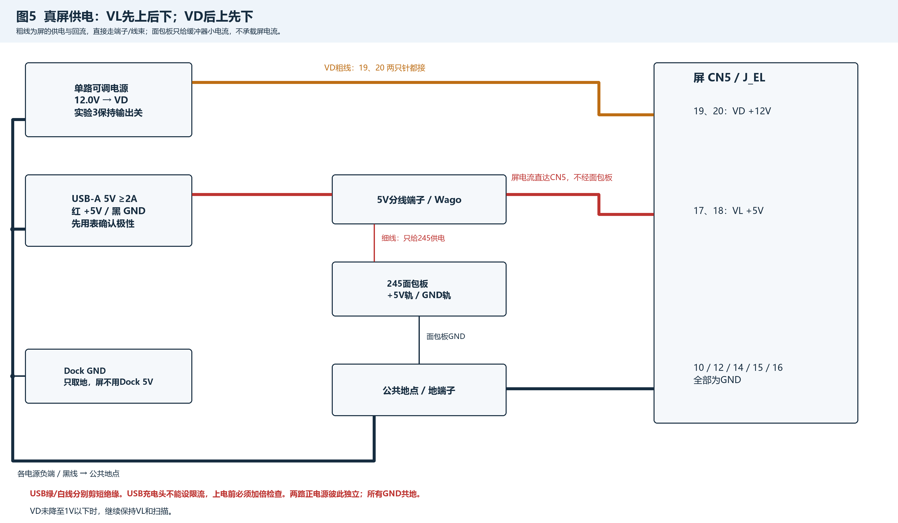
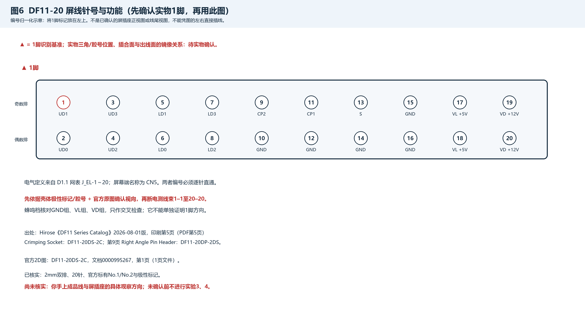
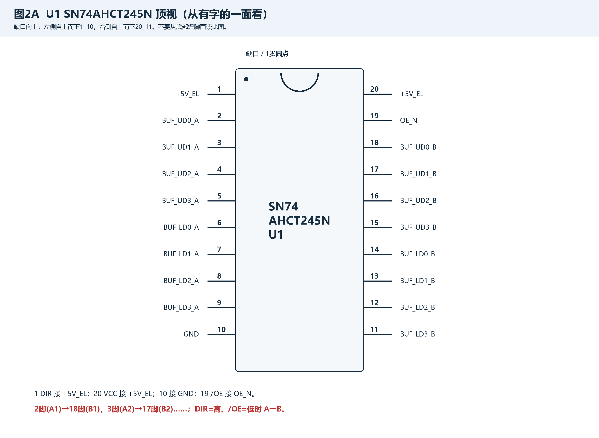
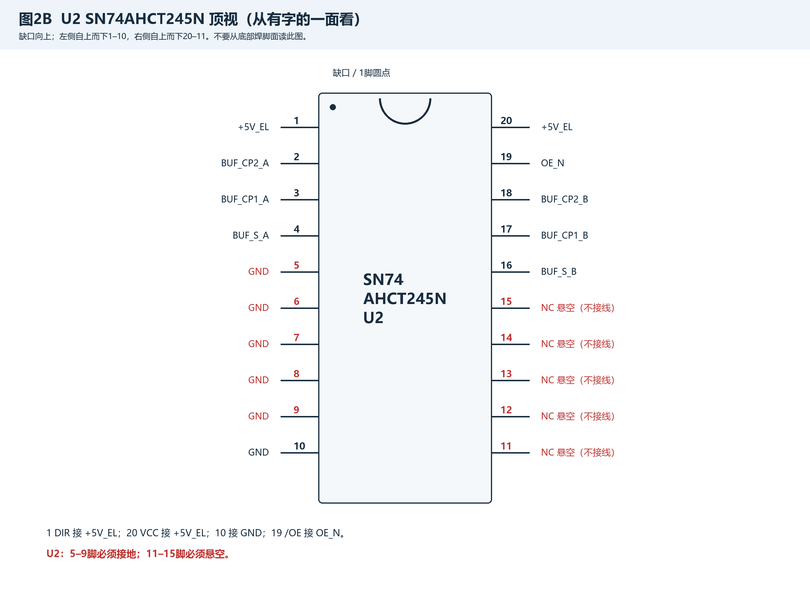
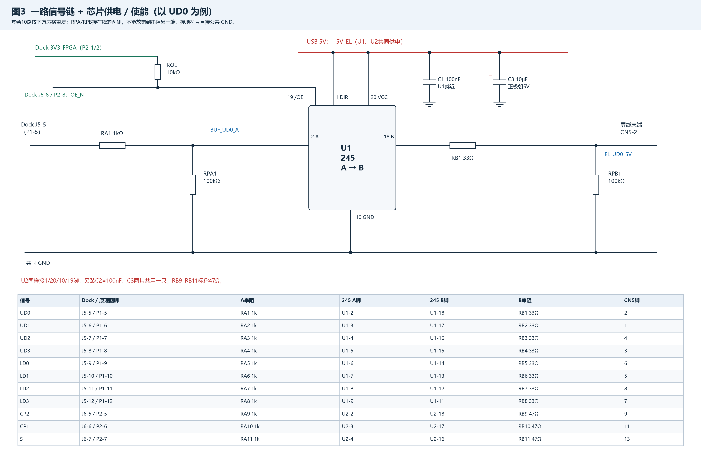
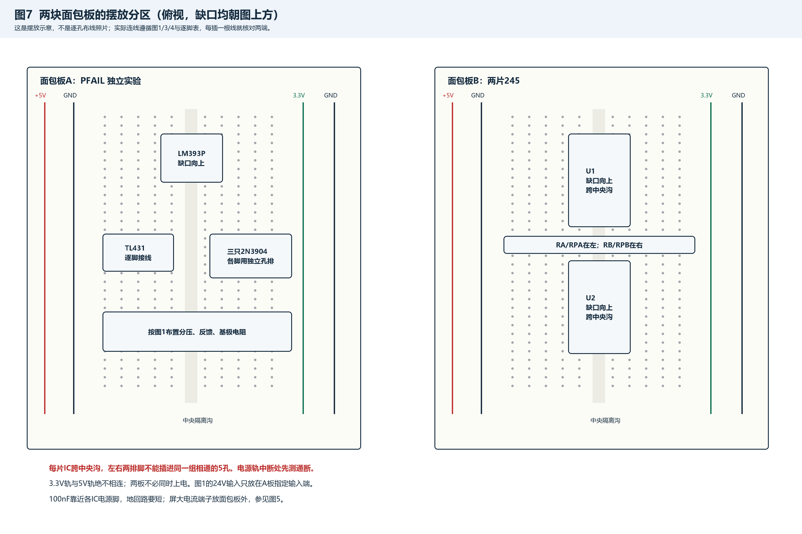
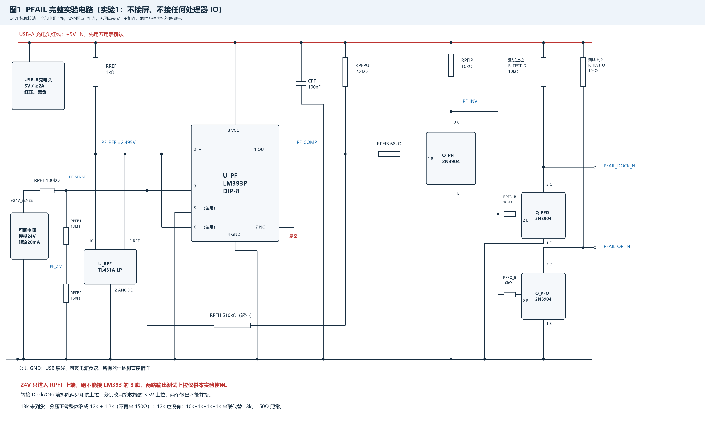
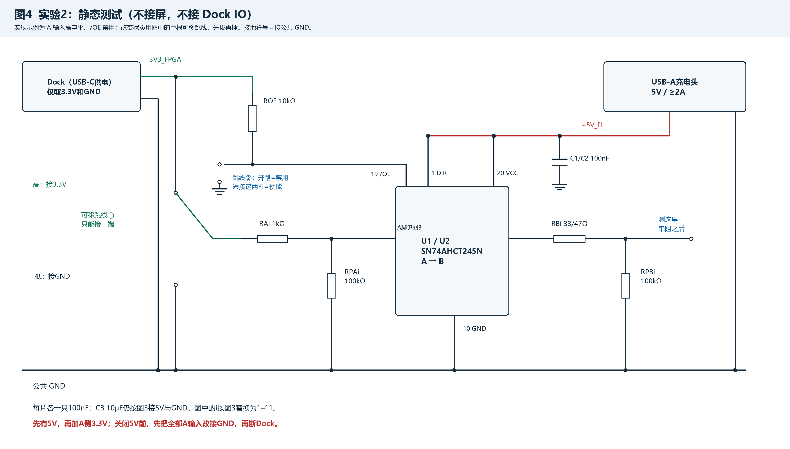

# MIS-01 EL驱动：面包板实验接线与验收 D1.1

> **2026-10-22 起本文档不再执行**：EL-IF D1.3 PCB 已直接下单（与面包板同一套电路，另有 eFuse 与贴片件），面包板实验 0–4 不做。
> 其中两条仍然有效、改在 PCB 上做：接屏前先不接屏看波形（CP1/CP2/S/8 路数据的 5 V 电平与时序），以及确认屏线 1 脚实物方向。步骤见 上电测试清单.txt 第 9 节。

2026-10-19。适用屏：Sharp LJ64K052。接线基准：D1.1/EL_IF_D1.1.net 与 D1.1/PFAIL_D1.1.net。

**先做实验0、1、2。实验3、4需要尚未完成的 FPGA 测试程序，现阶段不能按“已经能点屏”处理。** 元器件来自库存和本次商城采购（缺的阻值已补买，13k 订货中），用前逐只实测。这里的“通过”栏由实测后填写，所有空白都表示未测。

本次只新建实验文档和图，不改原理图、网表、BOM；旧 D1 文档保留，但不要混用其接线和参数。TPS259470 是小型 QFN，eFuse保护级、模块供电与主动放电留到PCB阶段验证。

## 原理图 PDF 怎么看

这两份PDF采用**网络标签式**画法：原理图上很多器件之间没有画长线，而是在每个引脚旁写网络名。**网络名完全相同的引脚，就是要用导线连在一起。** 标签位置远近、是否在同一页，都不改变连接关系。

- 位号：U_PF 是一片IC，RREF是一只电阻，Q_PFI是一只三极管，C1是一只电容；位号用来找到实物。
- 阻值：1kΩ=1000Ω，100kΩ=100000Ω；阻值是元件参数，不是针号。
- 引脚号：U_PF-2表示U_PF的第2脚；读脚号先确认封装的缺口/圆点和观察方向。
- 网络标签：PF_REF、PF_SENSE 是导线组的名字；名称不同不能直接并接。GND是公共参考地，+5V_IN、+5V_EL是原设计中的不同电源网络名。
- 电源符号：同名GND相连，同名电源相连。面包板中如何接实验电源，见本文供电表；不要把任何带“5V”的东西都随意并在一起。
- 灰色元件：本项目用灰色表示DNP（不安装），仍需看DNP属性/注释确认，不能只凭颜色判断。本文没有要求安装的可选保护/放电器件，不放到面包板上。
- 图中线交叉有实心圆点才相连；无圆点交叉不相连。新图用器件方框标脚号，方框不是外形照片。**面包板照本文的实线图和逐脚表接；PDF用于复核。**

### 两份 PDF 的每一页

[EL_IF_D1.1_原理图.pdf](D1.1/EL_IF_D1.1_原理图.pdf) 是屏接口、电平转换和最终PCB电源保护电路，共12页。

| PDF页 | 页名/内容 | 本次面包板用途 |
| --- | --- | --- |
| 1 | P1：Dock P1/P2/P3、屏接口J_EL | 查Dock与CN5针号 |
| 2 | P2：U1/U2缓冲器、C1/C2/C3 | 实验2–4 |
| 3 | P3：8路数据RA/RB/RPA/RPB | 实验2–4 |
| 4 | P4：CP2/CP1/S三路电阻、OE上拉 | 实验2–4 |
| 5 | P5：保护芯片、逻辑与功率器件 | PCB参考，不搭 |
| 6 | P6：电源保护电阻、门限分压 | PCB参考，不搭 |
| 7 | P7：电源电容与使能钳位 | PCB参考，不搭 |
| 8 | P8：电源/掉电/UART接口、旧测试点 | 查最终接口，不用来给面包板加电 |
| 9 | P9_VD_PRESENT_VL_FLT：VD状态与VL故障 | PCB参考，不搭 |
| 10 | P10_OPTIONAL_DISCHARGE：可选放电（DNP） | 不搭 |
| 11 | P11_INPUT_TRANSIENTS：输入钳位与可选储能 | PCB参考，不搭 |
| 12 | P12_PROBE_POINTS：新增测量点 | 对照最终PCB测量网络 |

[PFAIL_D1.1_原理图.pdf](D1.1/PFAIL_D1.1_原理图.pdf) 是独立掉电检测，共3页。

| PDF页 | 页名/内容 | 本次用途 |
| --- | --- | --- |
| 1 | PF1_COMPARATOR：U_PF、U_REF、RREF、RPFPU、RPFT、RPFH | 检测与迟滞 |
| 2 | PF2_DIVIDER_OUTPUTS：RPFB1/2、RPFIB、RPFIP、Q_PFI | 分压、反相 |
| 3 | PF3_DUAL_OUTPUTS：两路基极电阻/三极管、CPF、测试点 | 两路独立输出与去耦 |

完整例子：**PF_REF的五个成员都出现在PFAIL PDF第1页**：U_PF-2、U_PF-6、U_REF-1、U_REF-3、RREF-2。把这五个脚用导线接成一个公共点，就是PF_REF。U_REF-1与U_REF-3必须短接；U_REF-2接GND，不能一起短接到PF_REF。

## 先认清电源、接头和元件

### 本次只用的电源接法

| 阶段 | USB-A充电头5V | 单路可调电源 | Dock |
| --- | --- | --- | --- |
| 实验0 | 拔掉 | 输出关并断开 | 断电 |
| 实验1 | 只给PFAIL的+5V_IN | 模拟+24V_SENSE，限流20mA | 不接 |
| 实验2 | 只给两片245的+5V_EL | 不用 | USB-C供电，仅取3.3V/GND |
| 实验3 | 给缓冲器和屏VL | VD输出关 | 已有合格程序后接信号 |
| 实验4 | 给缓冲器和屏VL | 12.0V给VD | 合格黑场/图案程序 |

USB电源用**USB-A 5V充电头，额定至少2A，配剪开的USB-A线**。红线一般为+5V、黑线一般为GND，但必须先用万用表确认极性和电压，再断电接线；绿/白数据线剪短，分别绝缘，不互接。不要使用USB-C PD充电头作为这路5V源。给Dock供电的USB-C接口是另一件事，按Dock要求使用。

**USB充电头不能设限流，上电前必须加倍检查接线。** 屏VL、VD与回流用额定适配的端子/Wago和可靠线束直接连接；两只VL针、两只VD针和五只地针都要接。外部供电线可用短的0.5mm²铜线，再由合规线束各自分到DF11触点；不要把粗线硬塞进细小端子，触点线规按所购线束/端子规格。面包板只承载逻辑电路电流。

不要用可调电源12V再降成5V，不要用Dock的5V给屏供电。所有地共地，5V和12V正极不并接。实验1的模拟24V绝不能带进实验2–4的线束。

### 图6：屏线针号，未确认实物方向前不能接屏

图6将1脚放在左上，仅作编号归一化示意。Hirose官方资料可确认2mm双排结构、No.1/No.2和极性标记；目前没有你手上线束与屏插座的实物视向证据，**不能把图6的左右位置直接当作屏正面、插合面或出线面**。这项确认是实验3、4的前置条件。

出处：[Hirose DF11官方系列目录](https://www.hirose.com/en/product/document?clcode=CL0543-0555-4-06&documentid=en_DF11_CAT&documenttype=Catalog&lang=en&productname=DF11-10DS-2DSA%2806%29&series=DF11)，2026-08-01版印刷第5页（PDF第5页）：DF11-20DS-2C压接插壳、极性标记；第9页：DF11-20DP-2DS弯针插座。[DF11-20DS-2C官方2D图](https://www.hirose.com/en/product/document?clcode=CL0543-0509-7-00&documentid=0000995267&documenttype=2DDrawing&lang=en&productname=DF11-20DS-2C&series=DF11)，文档0000995267，第1页。针号功能按D1.1网表，不能从线的颜色推断。

| CN5针 | D1.1网络 | 功能 |
| --- | --- | --- |
| 1 | EL_UD1_5V | 上半屏数据1 |
| 2 | EL_UD0_5V | 上半屏数据0 |
| 3 | EL_UD3_5V | 上半屏数据3 |
| 4 | EL_UD2_5V | 上半屏数据2 |
| 5 | EL_LD1_5V | 下半屏数据1 |
| 6 | EL_LD0_5V | 下半屏数据0 |
| 7 | EL_LD3_5V | 下半屏数据3 |
| 8 | EL_LD2_5V | 下半屏数据2 |
| 9 | EL_CP2_5V | 数据移位时钟 |
| 10 | GND | 公共地 |
| 11 | EL_CP1_5V | 行锁存时钟 |
| 12 | GND | 公共地 |
| 13 | EL_S_5V | 帧起始标志 |
| 14 | GND | 公共地 |
| 15 | GND | 公共地 |
| 16 | GND | 公共地 |
| 17 | +5V_EL | VL逻辑电源 |
| 18 | +5V_EL | VL逻辑电源 |
| 19 | +12V_EL | VD驱动电源 |
| 20 | +12V_EL | VD驱动电源 |

### 两片245与11路信号

只用SN74AHCT245N直插DIP-20，认准AHCT，不能随手换成普通HC型号。芯片有字面朝上，缺口朝上时，左上1脚，左侧往下到10脚，右下11脚，右侧往上到20脚。U2的5–9脚接地，11–15脚悬空。

**2026-10-22 起脚号按 EL-IF D1.3 改了**（el_driver/D1.3/变更记录_D1.3.txt：P1–P3 改成与 Dock 相同的奇偶编号，信号换了脚位，FPGA .cst 同步改）。下表写新脚号，括号里是旧脚号；烧的若还是按旧 .cst 编的 .fs，就按括号里的旧脚号接。

下表“Dock J5/J6”为实物排针名称，“P1/P2”为D1.1原理图器件位号。实验2只把RA的输入端临时接3.3V/GND，不接这些Dock IO；实验3再按此表换接。先按Dock板丝印/官方排针资料认准J5/J6的1脚，不能仅凭连接器朝向估计。

| 信号 | Dock / D1.1 | A串阻 | A脚 | B脚 | B串阻 | CN5 |
| --- | --- | --- | --- | --- | --- | --- |
| UD0 | J5-9 / P1-9（旧 J5-5） | RA1 1kΩ | U1-2 | U1-18 | RB1 33Ω | 2 |
| UD1 | J5-11 / P1-11（旧 J5-6） | RA2 1kΩ | U1-3 | U1-17 | RB2 33Ω | 1 |
| UD2 | J5-12 / P1-12（旧 J5-7） | RA3 1kΩ | U1-4 | U1-16 | RB3 33Ω | 4 |
| UD3 | J5-10 / P1-10（旧 J5-8） | RA4 1kΩ | U1-5 | U1-15 | RB4 33Ω | 3 |
| LD0 | J5-8 / P1-8（旧 J5-9） | RA5 1kΩ | U1-6 | U1-14 | RB5 33Ω | 6 |
| LD1 | J5-6 / P1-6（旧 J5-10） | RA6 1kΩ | U1-7 | U1-13 | RB6 33Ω | 5 |
| LD2 | J5-7 / P1-7（旧 J5-11） | RA7 1kΩ | U1-8 | U1-12 | RB7 33Ω | 8 |
| LD3 | J5-5 / P1-5（旧 J5-12） | RA8 1kΩ | U1-9 | U1-11 | RB8 33Ω | 7 |
| CP2 | J6-9 / P2-9（旧 J6-5） | RA9 1kΩ | U2-2 | U2-18 | RB9 47Ω | 9 |
| CP1 | J6-11 / P2-11（旧 J6-6） | RA10 1kΩ | U2-3 | U2-17 | RB10 47Ω | 11 |
| S | J6-12 / P2-12（旧 J6-7） | RA11 1kΩ | U2-4 | U2-16 | RB11 47Ω | 13 |

C1/C2/CPF的100nF电容无极性；C3若用电解电容，按实物正负标识接线，负极条纹端接GND。旧剪脚元件不能只靠腿长短判断。

每路RPAi=100kΩ，1端接RAi之后的A节点、2端接GND；每路RPBi=100kΩ，1端接RBi之后的屏线节点、2端接GND。RAi-1是Dock输入端，RAi-2是A侧；RBi-1是B侧，RBi-2是屏线侧。所有电阻1%、普通轴向直插即可。RB1–8标称33Ω，RB9–11标称47Ω，试验改值另记。

| 器件脚/元件 | 接法 | 备注 |
| --- | --- | --- |
| U1-1、U1-20、U2-1、U2-20 | +5V_EL | 1=DIR，20=VCC |
| U1-10、U2-10 | GND | 两片共地 |
| U1-19、U2-19、ROE-2 | OE_N | 低使能，高禁用 |
| ROE-1 | 3V3_FPGA | ROE=10kΩ，不能上拉到5V |
| C1-1 / C1-2 | +5V_EL / GND | 100nF，U1就近 |
| C2-1 / C2-2 | +5V_EL / GND | 100nF，U2就近 |
| C3-1 / C3-2 | +5V_EL / GND | 10µF，1为正极 |
| U2-5/6/7/8/9 | GND | 未用A输入固定低 |
| U2-11/12/13/14/15 | 不接任何导线 | 未用B输出悬空 |
| P1-1/2、P2-1/2 | 3V3_FPGA | 任选已确认的3.3V供给ROE/静态输入 |
| P1-3/4、P2-3/4 | GND | 先共地 |
| P2-10（Dock J6-10，旧 J6-8） | OE_N | 仅实验3/4接IO；实验2不接 |
| P2-9、P2-10及其他控制/状态端 | 本手动点屏实验不接 | VD由可调电源人工控制 |

图7只指导摆放分区，不给未经实物验证的孔坐标。IC跨中央沟；一排5孔内部通常相连，左右半排隔沟不通；电源长轨可能中间断开。先用表测，必要时用短跳线跨接断开的同名电源段。5V轨与3.3V轨分开；PFAIL板的3.3V预留轨不使用。TO-92三条腿各用不同的独立孔排，不能插在同一组相通的5孔内。腿距不合适时断电轻轻展开，不能让裸腿相碰。

## 实验0：到货验收（全程不通电）

### 目的

确认元件值、脚号、面包板孔连通和屏线针号，避免靠色环、线色或外形猜接线。

### 所需设备

万用表（电阻/通断/二极管档）、两块面包板、跳线、已到货元器件、屏线、纸标签；三极管E/C不明确时使用与实物厂商一致的数据手册或晶体管测试仪/hFE插座辅助确认。USB线极性测量是本节末单独的空线检查，屏与面包板仍不接电。

### 接线表

| 检查项 | 表笔/接法 | 合格条件 |
| --- | --- | --- |
| 所有实验用电阻 | 元件脱离电路，两表笔接两端 | 与标称1%相符；记录表的仪表误差另计 |
| 面包板 | 同一半排5孔逐孔测；再测相邻排、隔沟和电源轨 | 确认实际内部连通，不短接相邻独立排 |
| 245/LM393 | 不接电，按缺口读顶视脚号 | 与图2和LM393脚表一致 |
| TL431AILP | 逐脚核对TI LP封装 | 1=CATHODE，2=ANODE，3=REF，中间脚接地 |
| 2N3904 | 二极管档检查B对另外两脚的正反向 | 先确认NPN和B，再按实物厂商资料确认E/C |
| 双头屏线 | 两端均断开，逐针测1–1到20–20；其余针应不通 | 无错位、无短路；不是凭颜色配对 |
| 单头屏线 | 先确认壳体腔号，每根线逐针测到对应腔位 | 给全部20根线贴号 |
| 屏CN5 | 屏断电且放电后测10/12/14/15/16、17/18、19/20分组 | 各组内部对应导通，跨组无稳定硬短路 |

### 逐步操作

1. 拔掉所有电源和屏线；电阻取出单独测，不在线路中并联测。先短接表笔看引线电阻，再逐只量并贴位号标签。
2. 把实验1与实验2元件分开放。13k未到货时，先量好替代串联组合的总阻值，不把它误当成单只13k。
3. 确认LM393P的DIP-8顶视脚号：缺口朝上，左边1、2、3、4往下，右边8、7、6、5往下。两片245按图2读。
4. TL431按TI数据手册SLVS543S表5-1核对。中间2脚是ANODE；本电路两个外脚1、3都接PF_REF，所以外脚互换不影响本接法，但不能误把中间脚接PF_REF。[TI TL431资料，印刷第4页表5-1](https://www.ti.com/lit/ds/symlink/tl431.pdf)
5. 对2N3904，通常红表笔接B、黑表笔依次接其余两脚会测得约0.55–0.8V，反向不导通。**二极管档通常只能可靠找B和判断NPN，不能单独可靠区分E/C。** D1.1网表按onsemi的1=E、2=B、3=C；若实物确为对应onsemi TO-92，平面朝自己、脚朝下为E-B-C；别的厂商先查自己的封装图。不能确认就先不插电。[onsemi 2N3903/2N3904资料，第1页与封装图](https://www.onsemi.com/pdf/datasheet/2n3903-d.pdf)
6. 测清面包板5孔排、电源轨分段。在纸上标5V、GND、3.3V；不同正电源轨不互接。
7. 用官方极性标记、壳体腔号和屏资料先建立1脚方向，再逐针测屏线；线束线尾看与插合面看会镜像，不能照图6左右直接套。
8. 屏断电时，核对上述三组供电针。内部电容可能造成短暂蜂鸣/充电读数，蜂鸣不能单独证明方向，也不能把跨组的瞬间鸣叫直接判为永久短路。
9. 最后只给未接负载的USB-A剪线插头通电，分别绝缘好裸线，用直流电压档确认红对黑为正5V，记下读数；然后拔USB再接面包板。切勿用电流档跨接红黑线。

### 测量点与期望值 / 记录表

| 检查项 | 标称/期望 | 实测 | 结论 |
| --- | --- | --- | --- |
| RA1–11，逐只附记录 | 1kΩ，±1% |  |  |
| RB1–8，逐只附记录 | 33Ω，±1% |  |  |
| RB9–11，逐只附记录 | 47Ω，±1% |  |  |
| RPA1–11/RPB1–11，逐只附记录 | 100kΩ，±1% |  |  |
| ROE、PFAIL电阻、测试上拉，逐只附记录 | 依接线表标称，±1% |  |  |
| 三只2N3904 | B已测；E/C厂商资料已核对 |  |  |
| TL431 | 2脚ANODE，外侧1/3接REF |  |  |
| 面包板 | 5孔、中央沟、电源轨分段已确认 |  |  |
| 屏线1–20 | 逐针对应，邻针无短路 |  |  |
| 屏接口方向 | 官方标记/实物与线束追踪相符 |  |  |
| USB空线 | 红对黑正5V；准备使用时4.75–5.25V |  |  |

逐只电阻附表可按下表复制，不能只测一只就认为同袋全部合格。

| 位号 | 标称 | 实测 | 合格/备注 |
| --- | --- | --- | --- |
| 待填 | 待填 | | |

### 常见问题

同排三条TO-92腿会短接；不同面包板的电源轨未必连续。三极管倒接可能仍有微弱反应，不能据此认定正确。屏线方向没把握先停在实验2，待确认实物后再接屏。

## 实验1：掉电检测 PFAIL（不接FPGA、不接屏）

### 目的

验证24V下降时两路独立报警、回升时解除，并量出迟滞。它只模拟检测输入，不为屏供电。

### 所需设备

USB-A 5V充电头及剪线、单路可调电源、万用表、面包板A、LM393P、TL431AILP、三只2N3904、下表电阻、CPF=100nF、两只额外10kΩ测试上拉、跳线。全部电阻1%，库存加采购件，用前按实验0逐只实测。

### 接线表

方框引脚是电气符号，不代表TO-92实物三条腿的画面顺序。以下表中1/2端是网表编号；普通电阻无极性，实物可两端互换，但两端必须接对网络。

| 器件 | 脚/端 | 连接到 | 说明 |
| --- | --- | --- | --- |
| U_PF LM393P | 1 | PF_COMP | 比较器A输出 |
| U_PF | 2 | PF_REF | A反相输入 |
| U_PF | 3 | PF_SENSE | A同相输入 |
| U_PF | 4 | GND | 电源负端 |
| U_PF | 5 | GND | 未用B同相输入 |
| U_PF | 6 | PF_REF | 未用B反相输入 |
| U_PF | 7 | 悬空 | 未用B输出 |
| U_PF | 8 | +5V_IN | 只能接USB5V |
| U_REF TL431AILP | 1 CATHODE、3 REF | PF_REF | 两脚短接 |
| U_REF | 2 ANODE | GND | 中间脚 |
| Q_PFI 2N3904 | 1 E / 2 B / 3 C | GND / PF_INV_B / PF_INV | 脚序须按实物确认 |
| Q_PFD 2N3904 | 1 E / 2 B / 3 C | GND / PF_D_B / PFAIL_DOCK_N | 独立输出1 |
| Q_PFO 2N3904 | 1 E / 2 B / 3 C | GND / PF_O_B / PFAIL_OPI_N | 独立输出2 |
| CPF 100nF | 1 / 2 | +5V_IN / GND | 就近接8–4脚，地回路短 |

| 电阻 | 标称 | 1端网络 | 2端网络 |
| --- | --- | --- | --- |
| RREF | 1kΩ | +5V_IN | PF_REF |
| RPFT | 100kΩ | +24V_SENSE | PF_SENSE |
| RPFB1 | 13kΩ | PF_SENSE | PF_DIV |
| RPFB2 | 150Ω | PF_DIV | GND |
| RPFH | 510kΩ | PF_COMP | PF_SENSE |
| RPFPU | 2.2kΩ | +5V_IN | PF_COMP |
| RPFIB | 68kΩ | PF_COMP | PF_INV_B |
| RPFIP | 10kΩ | +5V_IN | PF_INV |
| RPFD_B | 10kΩ | PF_INV | PF_D_B |
| RPFO_B | 10kΩ | PF_INV | PF_O_B |

| 实验外接线 | 一端 | 另一端 |
| --- | --- | --- |
| USB正/负 | +5V_IN | GND（两根线，正负分开） |
| 可调电源正/负 | +24V_SENSE（RPFT-1） | GND（负端） |
| R_TEST_D 10kΩ | USB +5V_IN | PFAIL_DOCK_N |
| R_TEST_O 10kΩ | USB +5V_IN | PFAIL_OPI_N |

两只R_TEST是本实验额外测试夹具，不在原生网表/BOM中。两路输出各接一只，不能并接两输出。它们上拉到5V时，**任何Dock/OPi IO都不能接进来**。以后接接收端前拆掉这两只上拉，改用各自3.3V上拉；那是另一个接法，不在本实验带电切换。

可在TPPF24、TPPF5、TPPFD、TPPFO、TPPFG对应网络留测量线头；不需要购买或安装PCB测试点焊盘。PF_REF五个脚必须全通；电源负端、CPF-2、三只发射极等所有GND都通。

### 13k未到货的替代接法

标称下臂是RPFB1=13kΩ，RPFB2=150Ω，总计13.15kΩ。替代只改变PF_SENSE到GND的下臂，其他元件不变。

| 方案 | PF_SENSE → PF_DIV → GND | 总阻值 | 预计下降报警 / 回升解除 |
| --- | --- | --- | --- |
| 标称D1.1 | 13kΩ → 150Ω | 13.15kΩ | 约21.0V / 21.9V |
| 13k未到 | 12kΩ → 1.2kΩ | 13.2kΩ | 约20.9V / 21.9V |
| 12k也没有 | 10kΩ+1kΩ+1kΩ+1kΩ串联代替13k → 150Ω照常 | 13.15kΩ | 约21.0V / 21.9V（同标称） |

**12k+1.2k方案替换整个下臂，原来的150Ω不再串入。** 最后一行只替换RPFB1：四只电阻串联放在13k的位置，RPFB2=150Ω照常接，下臂总值仍是13.15kΩ，门限与标称相同；四只之间的串联中间点不接任何其他线。PF_DIV在本电路无其他负载。

以上为工程估算，取PF_REF≈2.495V，比较器高约4.85V、低约0.10V：V24≈VREF×(1+100k/R下臂+100k/510k)−VCOMP×100k/510k。高态决定下降门限，低态决定回升门限；实际元件误差、温度和输出负载都会改变读数。20.5–21.5V是标称方案的工程验收范围，不代表所有温度/公差下的厂家保证。

### 逐步操作

1. 两电源都断开，按图1接完，用通断档逐网络核对上表；确认24V线只到RPFT-1，不进入LM393电源脚。
2. 暂时不接可调电源正线；它输出关闭，设置24.0V、限流20mA。先接共地，再在断电状态把正线接到RPFT-1。
3. 插USB给PFAIL的5V供电；先量U_PF-8对4脚约5V、PF_REF对地2.47–2.52V。若不对先拔USB查线，不开24V。
4. 开可调电源24V。两路输出应为高；量PF_COMP、PF_INV及两路输出，不用LED加载敏感节点。
5. 以约0.1V一步缓慢降压，至少跨过报警点，再升回24V。每步等读数稳定，分别记录发生翻转前/后的实际电压；掉压过快会漏掉门限。
6. 降、升各一遍为一轮，共三轮。每个翻转附近记录PF_REF、PF_SENSE、PF_COMP、PF_INV、两路输出对地电压；只有一只表时，重复慢扫分别测各节点，不能假称同时采样。
7. 先关模拟24V，再拔USB，断电后才改替代电阻或整理线束。实验结束撤掉模拟24V接线，避免下一实验误接。

### 测量点与期望值

| 状态/测点 | 期望 |
| --- | --- |
| PF_REF | 2.47–2.52V |
| 标称方案下降门限 | 约21.0V，工程接受20.5–21.5V |
| 标称方案回升门限/迟滞 | 约21.9V / 约0.9V；实测记入表 |
| 24V正常 | PF_COMP约4.5–5V；PF_INV接近0V；两路输出接近5V |
| 低于报警门限 | PF_COMP接近0V；PF_INV被两个基极支路加载，通常约2V；两路输出接近0V |
| 翻转瞬间PF_SENSE | 约等于PF_REF；正常24V时不要求它一直等于2.495V |

PF_INV低压报警时不会等于5V：两路10k基极支路会加载它，不要因为约2V就误判。两路输出低可先按≤0.4V检查，高按≥4.5V检查；这是5V/10k独立夹具的实测筛查标准。

### 记录表

电阻方案/实测总阻：________；USB电压：________；日期/仪表：________。

| 轮次 | 项目 | 预计 | 实测 | 结论 |
| --- | --- | --- | --- | --- |
| 1 | 下降报警电压 / 回升解除电压 / 差值 | 见所选方案 | | |
| 2 | 下降报警电压 / 回升解除电压 / 差值 | 见所选方案 | | |
| 3 | 下降报警电压 / 回升解除电压 / 差值 | 见所选方案 | | |

逐个状态填下表，三轮各复制一份；在下降翻转后、回升翻转后记录实际模拟输入电压。

| 测点 | 正常24V实测 | 下降报警后实测 | 回升解除后实测 |
| --- | --- | --- | --- |
| +24V_SENSE | | | |
| PF_REF | | | |
| PF_SENSE | | | |
| PF_COMP | | | |
| PF_INV | | | |
| PFAIL_DOCK_N | | | |
| PFAIL_OPI_N | | | |

### 常见问题

没有测试上拉，开集电极输出会悬空，不能以此判断报警；输出一直高，先查三极管E/C、GND与基极电阻。PF_REF错误先查TL431中间脚和RREF，不要继续开24V。两个门限相同或乱跳，先查510k反馈是否接在PF_COMP与PF_SENSE之间、量程步长和共地；不靠反复加电碰运气。

## 实验2：电平转换静态测试（不需要程序、不接屏）

### 目的

逐路检查针号、3.3V转5V、输出禁用与屏侧下拉。它不能证明动态时序已合格。

### 所需设备

USB5V源、Dock及其USB-C供电、万用表、面包板B、两片SN74AHCT245N、RA1–11、RB1–11、RPA1–11、RPB1–11、ROE、C1/C2/C3、短跳线。元件参数见前面的公共表。

### 接线表

| 线路 | 从哪里 | 到哪里 |
| --- | --- | --- |
| 5V | USB红线，经分线端子 | 两片245的1/20脚、C1/C2/C3正端 |
| GND | USB黑线、Dock GND | 两片10脚、全部下拉地端、电容地端、U2的5–9脚 |
| 3.3V | 已确认的Dock 3V3（P1-1/2或P2-1/2对应点） | ROE-1与输入高电平跳线源 |
| OE上拉 | ROE-2 | 两片19脚，**不接Dock J6-10 IO（旧 J6-8）** |
| OE跳线② | OE_N | 开路=禁用；接GND=使能 |
| 输入跳线① | 每路RAi-1 | 每次只选3.3V或GND；不接Dock IO |
| 输出测量 | 每路RBi-2 / RPBi-1 | 万用表红笔；黑笔GND |

其余固定接线逐项照前面的11路表与芯片公共表；U2闲置B输出11–15脚悬空。不要把3.3V直接接到OE后再用跳线短路到地，3.3V到OE中间必须有ROE=10kΩ。

### 逐步操作

1. USB与Dock断电，屏不接，所有RA输入跳线先接GND，OE接地跳线拔掉。逐脚核对图2与接线表。
2. 先开USB5V，量两片20–10脚在4.75–5.25V，再开Dock供3.3V；Dock IO保持完全不连接。3.3V与5V轨不能并在一起。
3. ROE使OE_N接近3.3V，输出禁用。逐路量RB之后，应被RPB拉到低电平。
4. 插OE_N到GND的跳线使能。逐路先拔掉该路RA-1到GND的跳线，再接RA-1到3.3V；量该路RB之后应高。然后先拔3.3V跳线，再接GND，应低。其余十路输入保持接地。
5. 每次只改一条输入，按11路表核对对应输出针；若其他输出跟着变，断电查错排/短接。高≥3.5V、低≤1.5V。
6. 保持某路输入高，拔掉OE接地跳线，确认该路输出回低；再把该输入改接GND。逐路做完记录。
7. 如要测静态5V电流，先关电，万用表用合适电流量程**串联在USB5V逻辑支路**再开电；不接屏。不要用电流档跨接5V与GND。两片245静态应是几mA级的量级；明显偏大或发热立即断电查。这个量级不是整套系统的严格额定上限。
8. 结束时全部RA输入先改接GND，OE接地跳线拔掉，再断Dock，最后关USB5V。RA的1kΩ只能限流，不能作为断电隔离。

### 测量点与期望值 / 记录表

| 项目 | 期望 | 实测 | 结论 |
| --- | --- | --- | --- |
| U1、U2各20–10脚 | 4.75–5.25V | | |
| Dock 3.3V轨 | 约3.3V | | |
| OE禁用 / 使能 | 约3.3V / 约0V | | |
| 5V静态电流 | 几mA级，无明显异常发热 | | |

| 信号 / 测量端 | OE禁用期望 | A=高期望 | A=低期望 | 实测：禁用/高/低 | 针号正确 |
| --- | --- | --- | --- | --- | --- |
| UD0 / RB1-2 | ≤1.5V | ≥3.5V | ≤1.5V |  |  |
| UD1 / RB2-2 | ≤1.5V | ≥3.5V | ≤1.5V |  |  |
| UD2 / RB3-2 | ≤1.5V | ≥3.5V | ≤1.5V |  |  |
| UD3 / RB4-2 | ≤1.5V | ≥3.5V | ≤1.5V |  |  |
| LD0 / RB5-2 | ≤1.5V | ≥3.5V | ≤1.5V |  |  |
| LD1 / RB6-2 | ≤1.5V | ≥3.5V | ≤1.5V |  |  |
| LD2 / RB7-2 | ≤1.5V | ≥3.5V | ≤1.5V |  |  |
| LD3 / RB8-2 | ≤1.5V | ≥3.5V | ≤1.5V |  |  |
| CP2 / RB9-2 | ≤1.5V | ≥3.5V | ≤1.5V |  |  |
| CP1 / RB10-2 | ≤1.5V | ≥3.5V | ≤1.5V |  |  |
| S / RB11-2 | ≤1.5V | ≥3.5V | ≤1.5V |  |  |

### 常见问题

全路没输出先查OE是不是仍被拉高、DIR是不是5V；一两路错先查U1/U2脚号，不要把右侧脚号顺着往下加。禁用后输出浮动多半是RPB没接在RB之后或GND断开。芯片发热先查电源反接、同排短接和3.3V/5V误并。

## 实验3：动态波形（等待FPGA测试程序）

### 目的

在真实屏输入负载下，验证信号幅度、边沿、串阻选择与完整扫描时序。只开VL，VD关闭；此时不以屏是否发光判断结果。

### 所需设备

实验2通过的两片245电路、已确认针序的真实屏/线束、USB5V、Dock/FPGA及**尚待完成并审查的测试程序**、示波器（现有≥50MHz即可看清时序和电平；30ns级边沿读数会偏慢，边沿结论以≥100MHz复测为准；配匹配探头和短地弹簧）、万用表、端子与短线、用于替换RB的100/82/68/47/33Ω电阻（库存都有，用前实测）。

### 程序前置要求（本交付不编写RTL）

依据设计笔记§8.3，这些是待实现和实测的候选参数：

- 时钟候选54MHz；CP2=54MHz/10≈5.4MHz，高/低各5tick，周期约185.19ns，高/低各92.59ns。
- 先60Hz、每帧240行对，每行对160个CP2；每行对3750tick≈69.444µs，160组有效传输占约29.63µs，其余时间合理分配给等待/锁存；不能让CP2整帧无间断自由运行后仍声称60Hz。
- UD[3:0]/LD[3:0]按屏数据格式送数，CP2下降沿采样；候选在CP2上升沿附近改数据，最终以CN5实测建立/保持为准。
- 数据传完后再给CP1锁存脉冲，候选高8tick≈148.15ns；以CP1下降沿为新行周期起点，至少等8tick再发首个CP2上升沿。S跨首个有效行对的CP1下降沿有效，其他行锁存时为低；满足Sharp完整CP1/CP2/S关系。
- 复位后OE_N=1，数据与扫描信号全部低；程序准备好后能保持完整黑场扫描，并能受控拉低OE_N、切换黑场/全亮/棋盘格/稀疏图案。复位阶段OE_N是例外，不能同时要求它为低。
- 有效帧从第一行真实数据开始；不直接照搬HDMI总行场消隐。程序版本、引脚约束、PLL锁定、全帧计数和复位行为都要可核对。

**上述程序未完成前，停在实验2。** 不用随机IO翻转、CPU软件循环或仅一个方波替代完整扫描。

### 接线表

| 项目 | 接法 |
| --- | --- |
| 11路输入 | 撤掉实验2所有3.3V/GND输入跳线；按11路表把Dock IO接RA输入端 |
| OE | 撤掉实验2的OE接地跳线，Dock J6-10接OE_N（旧 J6-8）；ROE仍在 |
| 5V | USB→端子→屏CN5 17/18，同时→两片245；不经面包板给屏供电 |
| 地 | CN5 10/12/14/15/16、USB、Dock、可调电源负端共地 |
| VD | 可调电源输出关闭，CN5 19/20没有12V供电，实测VD低于1V |
| 示波器 | 探头尖端接CN5侧被测信号；短地弹簧接附近CN5 GND；不能夹VD/VL正极 |

供电回路按图5，信号按图3；禁止带电插拔CN5。普通台式示波器各通道地夹通常共地并接保护地，只夹已确认的公共GND，不为测量断开保护地。

### 逐步操作

1. 确认程序已完成、实验2通过、屏线实物1脚已确认，所有电源关闭后才接真屏。VD输出关；暂时不用VD正线时，断电拆下并单独绝缘。
2. USB先开VL，量CN5 17/18对本地GND为4.75–5.25V，量VD低于1V，再开Dock。OE_N保持1，确认FPGA端/A端已有完整黑场时序。
3. 软件把OE_N设0，再在CN5侧测CP2、CP1、S及全部数据。只开VL不亮屏是正常现象；不得为“看看亮不亮”提前开VD。
4. 先验证标称RB组合：数据33Ω，CP2/CP1/S 47Ω。记录CN5端幅度、最大/最小峰值、10–90%上升和下降时间，以及建立/保持。
5. 比较RB时，每次只改一个位号/通道，顺序100→82→68→47→33Ω。**先保持VD关闭，停止驱动并断Dock，再关USB，确认5V/VD已放掉后更换**；记清位号、实际阻值、线长、探头配置。换值后按VL→Dock→合法扫描的顺序重新开机。
6. 对CP2和代表性数据先筛选，再对最终选定组合复核全部11路。不能只看过冲最小；幅度、边沿、建立/保持都要同时合格。
7. 切换需要的数据测试图用于波形检查，VD仍关闭；统计每行对/每帧脉冲数量，不只看频率计。保存示波器截图与原始波形。
8. 全部项目通过才进入实验4。面包板寄生较大，若高频波形不合格，先缩短线和改善接地；仍不合格则停止点屏，记录待PCB验证，不靠打开VD“试试看”。

### 测量点与期望值 / 记录表

下列限值来自本项目任务书及Sharp规格；在CN5端、相对本地GND测量。VL上限也用于计算峰值上限。

| 项目 | 期望 | 实测 | 通过 |
| --- | --- | --- | --- |
| CN5 VL | 4.75–5.25V | | |
| CN5 VD | 关闭，低于1V | | |
| 每路逻辑高 / 低 | ≥3.5V / ≤1.5V | | |
| 每路最大/最小峰值 | −0.3V至VL+0.3V之间 | | |
| 每路10–90%上升/下降 | 均≤30ns | | |
| CP2周期 | ≥154ns；候选约185.19ns | | |
| CP2高/低脉宽 | 各≥60ns；候选约92.59ns | | |
| 数据对CP2下降沿建立/保持 | ≥50ns / ≥40ns | | |
| 每行对CP2组数 | 160 | | |
| 每帧行对数 | 240 | | |
| 帧率 | 首轮60Hz，屏允许60–120Hz | | |
| CP1 / S相对关系 | 符合Sharp规格p.8（PDF第12页）时序图及笔记§8.3 | | |

串阻逐档比较记录：每个被测位号复制5行；最终全部11路均须留记录。

| 位号/信号 | RB实测Ω | VL实测 | 峰值最小/最大实测 | 上升/下降实测ns | 建立/保持实测ns | 结论/波形文件 |
| --- | --- | --- | --- | --- | --- | --- |
| 待填 | 100 |  |  |  |  |  |
| 待填 | 82 |  |  |  |  |  |
| 待填 | 68 |  |  |  |  |  |
| 待填 | 47 |  |  |  |  |  |
| 待填 | 33 |  |  |  |  |  |

程序版本/约束文件：________；线束长度：________；示波器/探头/带宽设置：________；测量日期：________。

### 常见问题

只有CP2而无CP1/S不能点屏。OE_N=1时CN5无扫描是预期；在A端确认后使能，再核验CN5。长鳄鱼夹地线会制造假振铃，应先换短地弹簧复测；不能以较慢时基或带宽限制掩盖尖峰。数据固定黑时看不到数据边沿，需用可控交替图案且继续保持VD关闭。面包板不保证5.4MHz下波形自然合格。

## 实验4：首次点屏（实验3全部通过以后）

### 目的

用单路可调电源与独立USB5V，按正确顺序首次点亮真实屏，记录电流、自然掉压和显示状态。

### 所需设备

实验3整套已验收线路与合格程序、单路可调电源、USB5V充电头、万用表、示波器、可靠端子/线束。没有仪器替代采购要求；若无法验证波形，先不进入本实验。

### 接线表

| 线路 | 正端 | 回流/检查 |
| --- | --- | --- |
| VL | USB5V经端子到CN5 17/18及245 VCC | USB黑线到公共地；VL不走面包板触点 |
| VD | 可调电源12.0V到CN5 19/20 | 负端到公共地；初始输出关 |
| 屏GND | CN5 10/12/14/15/16全接 | 公共地同时接USB/Dock/245/电源负端 |
| 数字信号 | 11路按图3到CN5 | 接线与实验3通过时一致 |
| VD测量 | 万用表电压档红笔CN5 19/20 | 黑笔屏GND；看实际掉压，不只看电源面板 |

参照图5。初始VD限流1.0A，仅黑场/稀疏图案；无异常后再以2.0A测试全亮。本流程上限2.0A，绝不调到3A以上。限流不是保险丝动作的保证，电源输出电容也可能释放瞬时电流，不做短路试验。USB5V无可设限流，不能套用双路电源对VL的限流步骤。

### 逐步操作

1. 可调电源输出关、USB拔掉、Dock断电。断电接好线束与所有地，再复核5V/12V没接反、屏线针序正确，没有裸线互碰。
2. 电源设12.0V、限流1.0A但保持输出关。先插USB开VL；在CN5端量VL 4.75–5.25V，VD仍低于1V。
3. Dock上电，加载合格测试程序；OE_N先保持1，在FPGA/A端确认黑场完整时序。再置OE_N=0，在CN5端确认CP2/CP1/S及数据均为实验3通过的状态。保持完整黑场扫描。
4. **最后**打开可调电源VD输出。看电源实际电压/电流和屏状态，先做黑场、稀疏图案；若进入恒流、异常闪烁或VD显著下陷，先关VD，继续保持VL和扫描待VD掉压，再按关机顺序处理；不直接增加限流掩盖问题。
5. 黑场与稀疏图案稳定后，先按完整顺序关机，在VD关闭且掉压后把限流改2.0A，再完整上电做全亮/棋盘格；记录电流和显示。不要带电拔插屏线或电阻。
6. 关机时**先关VD输出**，用CN5端实测确认VD低于1V；等待期间继续保持VL和完整扫描。然后让程序禁用输出、停扫描/断Dock；**最后拔USB关VL**。
7. 用示波器记录VD自然下降时间（从关输出到CN5 VD<1V）。只有万用表时，只能记大致秒级/显示更新范围，不把它当精确瞬态波形。电源“关输出”后不一定立即为0V。
8. 屏内部有约200V交流高压，断电后也可能残留；任何时候不碰背面驱动板，不带电插拔CN5。接线或换图案条件异常时先按顺序关机再查。

### 测量点与期望值 / 记录表

VD<1V是本项目关机操作门槛，不是对Sharp原厂时序图标注的逐字转述。VL先上后下、VD后上先下，见本地LJ64K052.pdf规格p.16及设计笔记§16.4。

| 项目/图案 | 设置/期望 | 实测 | 结论/现象 |
| --- | --- | --- | --- |
| 开VD前VL | CN5端4.75–5.25V | | |
| 开VD前扫描/OE | 黑场完整扫描，CN5时序通过，OE_N=0 | | |
| 黑场 VD电压/电流 | 12.0V设定，限流1.0A；不持续进入恒流 | | |
| 稀疏 VD电压/电流 | 同上 | | |
| 全亮 VD电压/电流 | 12.0V设定，限流2.0A；无异常 | | |
| 棋盘格 VD电压/电流 | 同上 | | |
| 各图案VL最小/最大 | 4.75–5.25V | | |
| 关VD到低于1V时间 | 记录自然下降；此间保持VL/扫描 | | |
| 显示质量 | 记录亮度、闪烁、缺行、错行、异响 | | |

日期/屏序列号：________；程序版本：________；USB/电源型号：________；线束长度：________；波形文件：________。

### 常见问题

VL开而VD关时不发光是正常的；全亮进入限流不代表可以把限流越调越大。画面滚动/错行，先关VD再查S、CP1和行对数；高电平、扫描频率合格不等于数据顺序正确。关电源后VD下降慢，保持VL和扫描等待，不能先拔USB催它断电。

## 本轮完成与下一步

本文交付的是接线与验收方案，**没有进行实物通电，也没有宣称通过实验或仿真证明整屏可用**。完成0→1→2以后，先完成FPGA测试程序并确认屏线实物方向，再做3→4；留下实测记录供PCB阶段选定串阻与核对保护方案。

审核用资料集中在[交付说明](面包板图_D1.1/交付说明.txt)与[接线校验结果](面包板图_D1.1/src/接线校验结果.json)。可将本文件、8张PNG、D1.1两份网表/两份PDF与交付说明一起交给Claude复核；本次尚未发生Claude审核。
